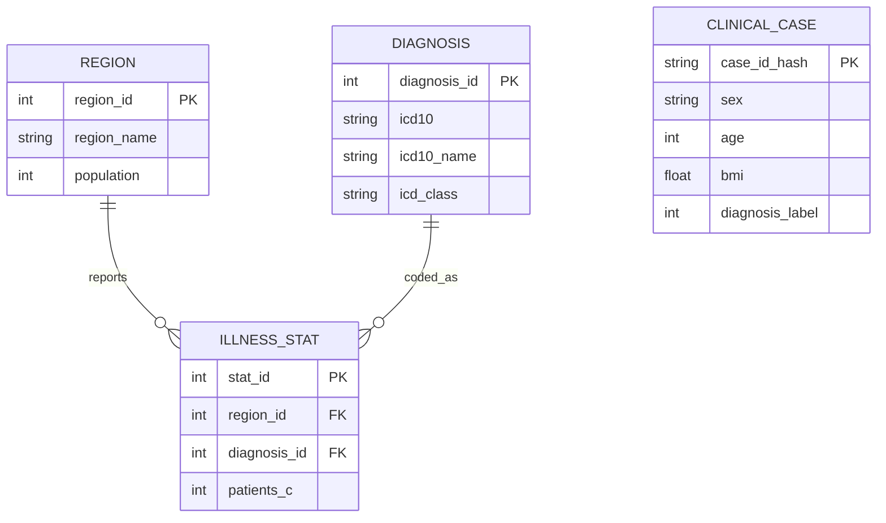

# ER diagram (logical) — real Ashyq clinical + egov illnesses

Notes:
- `clinical_case` = Ashyq clinical CSV (no fabricated ICD/region/dates).
- `illness_stat` = real egov open-data aggregates filtered to liver ICD-10.
- No synthetic observation / dispensary / organization medical entities.
